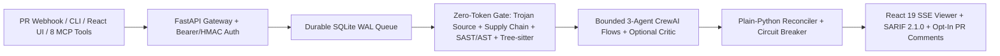
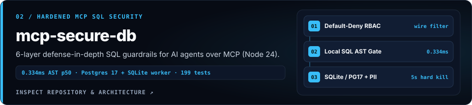
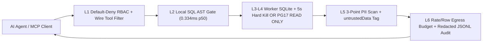
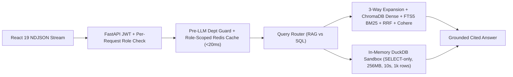
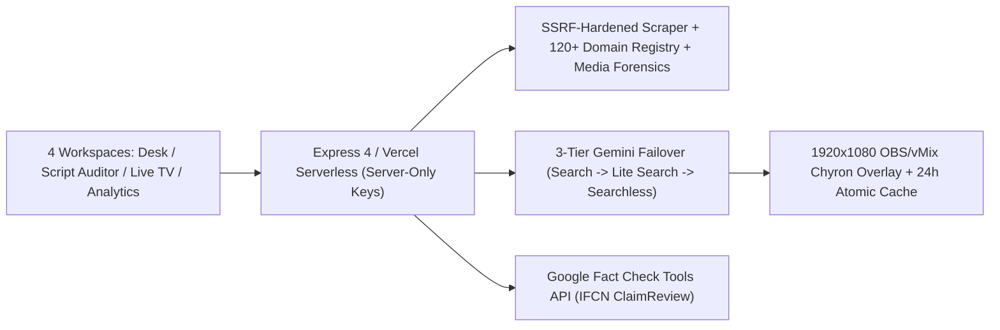

  <a href="https://personalportfolio-theta-gules-56.vercel.app/">
    <picture>
      <source media="(prefers-color-scheme: light)" srcset="assets/hero-light.svg">
      
    </picture>
  </a>

  
  
  
  

  <a href="#about">About</a> · <a href="#flagship-systems">Flagship systems</a> · <a href="#evidence">Proof</a> · <a href="#more-work">More work</a> · <a href="#stack">Stack</a> · <a href="#contact">Contact</a>

---

## Hi, I'm Hamza 👋

I build **AI systems that are safe to put in front of real users and real data** — agents, RAG and text-to-SQL that can't leak what a user isn't allowed to see, can't run unsafe queries, and come with tests that prove it.

<table>
  <tr>
    <td align="center" width="25%"><h3>979+</h3>automated tests across flagship repositories</td>
    <td align="center" width="25%"><h3>4</h3>full-stack AI systems with CI &amp; audit docs</td>
    <td align="center" width="25%"><h3>0</h3>metadata-filter leaks in FinSight RBAC evals</td>
    <td align="center" width="25%"><h3>0.334ms</h3>p50 local SQL AST validation (mcp-secure-db)</td>
  </tr>
</table>

**How I work**

- 🧱 **Deterministic before probabilistic** — parsers, AST scanners and RBAC gates run *before* any LLM call, at zero token cost.
- 🔐 **Security in code, not in prompts** — role isolation, PII guards and SQL/worker sandboxes block bad operations before they reach data or models.
- 📏 **Honest, measured reliability** — regression, fuzz and differential tests, RAGAS evals, and every limitation written down next to the result.

📍 **Lahore, Pakistan · UTC+5 · Remote** &nbsp;|&nbsp; 💼 Open to **Full-Stack AI**, **Forward-Deployed AI** and **LLM Systems** roles, plus select AI architecture & reliability advisory.

---

## 🚀 Flagship systems

| | |
| :--- | :--- |
| **Problem** | LLM code reviewers hallucinate findings and burn tokens on issues a static tool can catch for free. |
| **Built** | Zero-token SAST/AST + 6-language Tree-sitter pre-scan → bounded 3-agent CrewAI Flows crew → plain-Python reconciler. Ships as a FastAPI gateway, React 19 live viewer, 8 MCP tools, a GitHub Action and a SARIF 2.1.0 exporter. |
| **Proof** | `690+` Pytest tests · `14/14` seeded-defect regression (`18 TP / 0 FP / 0 FN`) · `20/20` real Flask PRs captured (`3.72s` mean) |

`Python` `FastAPI` `CrewAI Flows` `Tree-sitter` `Semgrep` `MCP` `React 19` `Docker` `SARIF`

**[Repository](https://github.com/hamza1713/AI-Code-Review-Agent) · [Architecture](https://github.com/hamza1713/AI-Code-Review-Agent/blob/main/docs/ARCHITECTURE_AND_STRUCTURE.md) · [Benchmarks](https://github.com/hamza1713/AI-Code-Review-Agent/blob/main/BENCHMARK_REPORT.md) · [Case study](https://personalportfolio-theta-gules-56.vercel.app/projects/ai-code-review-agent)**

<b>Architecture &amp; evaluation scope</b>

- **Also includes:** Trojan Source (CVE-2021-42574) stripping, slopsquatting checks, AST constant-folding/taint analysis, 15 PR slash commands, Python 3.10–3.13 CI matrix.
- **Scope:** Synthetic fixtures verify known-pattern retention, not real-world precision/recall; real Flask PR adjudication is tracked as `UNREVIEWED` in `BENCHMARK_REPORT.md`. Advisory by default — PR posting and auto-remediation are off unless enabled.

 

| | |
| :--- | :--- |
| **Problem** | Giving an AI agent database access usually relies on a prompt saying "please only read". |
| **Built** | A TypeScript/Node 24 MCP server with six independent fail-closed layers: default-deny RBAC with wire-level tool filtering, local SQL AST validation, sandboxed SQLite worker (5s hard kill) or PostgreSQL 17 `READ ONLY`, PII guards, rate/row budgets and redacted audit logs. |
| **Proof** | `199` tests — `32` bypass vectors, `93` differential, `300` fuzzed queries, `32` red-team, `25` PII · `0.334ms` p50 validator · CI claims-linter |

`TypeScript` `Node.js 24` `MCP (mcp-use)` `node-sql-parser` `SQLite` `PostgreSQL 17` `Vitest` `Docker`

**[Repository](https://github.com/hamza1713/mcp-secure-db) · [Claims register](https://github.com/hamza1713/mcp-secure-db/blob/main/docs/CLAIMS.md) · [Tests](https://github.com/hamza1713/mcp-secure-db/tree/main/tests) · [Benchmark](https://github.com/hamza1713/mcp-secure-db/blob/main/bench/validator.bench.ts)**

<b>6-layer defense stack &amp; limitations</b>

- **Scope:** A reference implementation. It mitigates the tested SQL/PII/DoS classes without claiming formal proof or GDPR/HIPAA/SOC 2 certification, and cannot stop a prompt-injected agent from reading data its own role is allowed to read.

 

| | |
| :--- | :--- |
| **Problem** | Company chatbots leak documents across departments when access control lives inside the system prompt. |
| **Built** | *(B.S. CS Final Year Project)* A multi-department AI workspace answering plain-English questions over documents **and** spreadsheets — 3-layer RBAC enforced before retrieval, hybrid search (ChromaDB + BM25 + RRF + Cohere Rerank), an isolated DuckDB SQL sandbox and role-scoped Redis streaming cache. |
| **Proof** | `90` tests (`20` OWASP security) · `0.933` RBAC score with `0` filter leaks across 6 roles · `0.894` RAGAS relevancy · `<20ms` cache hits |

`Python` `FastAPI` `React 19` `LangChain` `ChromaDB` `DuckDB` `Redis` `Cohere` `RAGAS` `Docker Compose`

**[Repository](https://github.com/hamza1713/Enterprise-RAG-Chatbot-with-Role-Base-Access-Control-) · [Security tests](https://github.com/hamza1713/Enterprise-RAG-Chatbot-with-Role-Base-Access-Control-/blob/main/verification/test_security.py) · [Readiness report](https://github.com/hamza1713/Enterprise-RAG-Chatbot-with-Role-Base-Access-Control-/blob/main/PRODUCTION_READINESS_REPORT.md) · [Case study](https://personalportfolio-theta-gules-56.vercel.app/projects/finsight)**

<b>Retrieval / SQL pipeline &amp; staging boundaries</b>

- **Evals:** `11/12` blocked on RBAC probes (one documented general-doc `"revenue"` edge case) · dual-track relevancy `0.840` quota-free / `0.894` RAGAS · `0.850` faithfulness.
- **Scope:** Documented as a **staging candidate**; remaining production gates are tracked in `PRODUCTION_READINESS_REPORT.md`.

 

| | |
| :--- | :--- |
| **Problem** | Newsrooms need fast claim verification that keeps working — and stays honest — when AI quotas run out. |
| **Built** | Four editorial workspaces across web, desktop (Electron 36) and live TV: claim breakdown with IFCN `ClaimReview` + Google Search grounding, a pre-publication script compliance auditor, a 1080p OBS/vMix chyron overlay, and a 3-tier Gemini failover engine. |
| **Proof** | Server-only API keys · SSRF shield blocking loopback/RFC1918/cloud metadata · `120+` domain credibility registry · explicit "searchless" freshness warnings |

`TypeScript` `React 19` `Express` `Electron 36` `Tailwind v4` `Gemini 2.5 Flash` `Vercel Serverless`

**[Repository](https://github.com/hamza1713/Factscope-AI) · [Security checklist](https://github.com/hamza1713/Factscope-AI/blob/main/SECURITY_CHECKLIST.md) · [AI engine](https://github.com/hamza1713/Factscope-AI/blob/main/server/services/aiEngine.ts) · [Case study](https://personalportfolio-theta-gules-56.vercel.app/projects/factscope-ai)**

<b>Newsroom &amp; broadcast pipeline + failover trade-offs</b>

- **Scope:** Confidence percentages are heuristic indicators, not calibrated accuracy; cited sources always require editorial review before broadcast.

---

## ✅ Proof at a glance

Every number above links back to code, tests or a report you can open.

| System | Key safeguard | Evidence | CI / audit |
| :--- | :--- | :--- | :--- |
| **[AI Code Review Agent](https://github.com/hamza1713/AI-Code-Review-Agent)** | Zero-token static gate before any agent | `690+` tests · `18 TP / 0 FP / 0 FN` |  · [Benchmarks](https://github.com/hamza1713/AI-Code-Review-Agent/blob/main/BENCHMARK_REPORT.md) |
| **[mcp-secure-db](https://github.com/hamza1713/mcp-secure-db)** | 6 fail-closed layers for agent SQL | `199` tests · `0.334ms` p50 |  · [Claims](https://github.com/hamza1713/mcp-secure-db/blob/main/docs/CLAIMS.md) |
| **[FinSight](https://github.com/hamza1713/Enterprise-RAG-Chatbot-with-Role-Base-Access-Control-)** | RBAC enforced before retrieval | `90` tests · `0` filter leaks |  · [Readiness](https://github.com/hamza1713/Enterprise-RAG-Chatbot-with-Role-Base-Access-Control-/blob/main/PRODUCTION_READINESS_REPORT.md) |
| **[Factscope-AI](https://github.com/hamza1713/Factscope-AI)** | Server-only keys + SSRF shield | 3-tier failover · `120+` domain registry | [Security checklist](https://github.com/hamza1713/Factscope-AI/blob/main/SECURITY_CHECKLIST.md) |

> **Recruiters — 2-minute path:** open the [AI Code Review Agent architecture](https://github.com/hamza1713/AI-Code-Review-Agent/blob/main/docs/ARCHITECTURE_AND_STRUCTURE.md), then the [mcp-secure-db claims register](https://github.com/hamza1713/mcp-secure-db/blob/main/docs/CLAIMS.md), then try the [interactive Systems Lab](https://personalportfolio-theta-gules-56.vercel.app/#lab).

---

## 🧪 Open source &amp; more work

| Project | What it is | Links |
| :--- | :--- | :--- |
| **Upstream OSS · `mcp-use`** | Contributed a role-based SQLite MCP server example showing `mcp-use` RBAC middleware (PR #3055, open). | [Pull request](https://github.com/mcp-use/mcp-use/pull/3055) |
| **Interactive Portfolio &amp; Systems Lab** | React/TypeScript site with a Workflow Explorer, Token &amp; Cost Estimator, 8-tool MCP Inspector and Benchmark Matrix. | [Live](https://personalportfolio-theta-gules-56.vercel.app/) · [Code](https://github.com/hamza1713/Portfolio) |
| **Autonomous Social Media Brand Manager** | 5-agent CrewAI pipeline (strategy, copy, brand voice, engagement, analytics) with Streamlit/CLI UI. | [Code](https://github.com/hamza1713/Autonomous-Social-Media-Brand-Manager) |
| **Deep-Fake Detection** | Experimental multimodal media-analysis app (React + Gemini); outputs scoped as heuristic observations. | [Live](https://deep-fake-detection-pi.vercel.app) · [Code](https://github.com/hamza1713/Deep-Fake-Detection) |
| **Airline Satisfaction ML** | Tabular ML workflow: feature engineering, cross-validated XGBoost, held-out evaluation. | [Code](https://github.com/hamza1713/DS-ML-PROJECTS) |

---

## 🛠️ Tech stack

| | |
| :--- | :--- |
| **AI &amp; agents** | Python · TypeScript · CrewAI Flows · LangGraph · LangChain · MCP · Gemini / Claude APIs · RAGAS · DeepEval · PyTorch · scikit-learn · XGBoost |
| **Retrieval &amp; data** | Hybrid search (dense + BM25) · RRF · Cohere Rerank · ChromaDB · DuckDB · PostgreSQL · SQLite · Redis |
| **Security &amp; quality** | Tree-sitter · Semgrep · Bandit · JWT/RBAC · Pytest · Vitest · Playwright · Ruff · mypy · Gitleaks |
| **Backend &amp; frontend** | FastAPI · Node.js · Express · SSE/NDJSON streaming · React 19 · Vite · Tailwind CSS · Electron |
| **Infra** | Docker · GitHub Actions · Vercel · Caddy · Azure ML |

---

## 🤝 Let's build something

Hiring for a **remote Full-Stack / Forward-Deployed AI** role, or scoping a production **RAG, MCP or agent-reliability** system? I'd love to hear about it.

<b>What I can help your team ship</b>

1. **Enterprise RAG &amp; text-to-SQL with access control** — zero-leak multi-tenant retrieval and sandboxed analytics.
2. **Hardened MCP tool servers** — default-deny RBAC, query validation, sandboxing, PII guards and audit trails for Claude, Cursor and in-house agents.
3. **Deterministic-first multi-agent workflows** — static guardrails ahead of bounded CrewAI / LangGraph orchestration.
4. **LLM reliability &amp; evaluation audits** — RAGAS + custom eval suites, fuzz/differential harnesses and clear degradation paths.

📧 [hamza171324@gmail.com](mailto:hamza171324@gmail.com?subject=Hello%20Hamza) · 💼 [LinkedIn](https://www.linkedin.com/in/hamza-ali-ai/) · 🌐 [Portfolio](https://personalportfolio-theta-gules-56.vercel.app/) · 📄 [Resume](https://personalportfolio-theta-gules-56.vercel.app/assets/Hamza_Ali_Resume_GenAI_Engineer.pdf)

Metrics, test counts and diagrams verified against the public repositories — November 2026.

<a href="#top">Back to top ↑</a>

