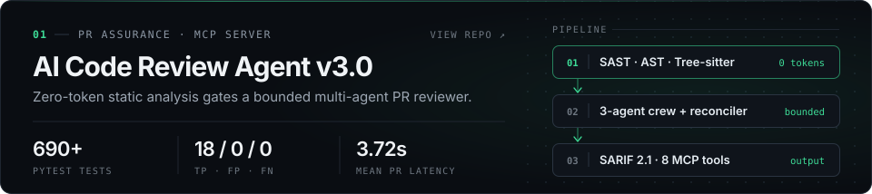
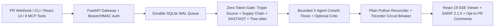
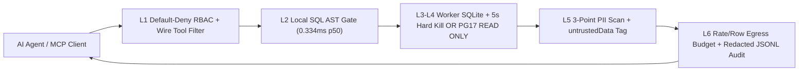
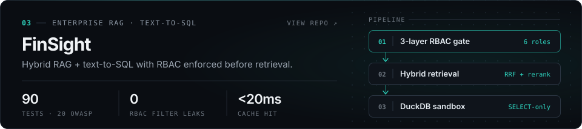
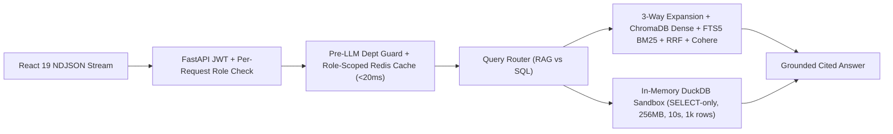
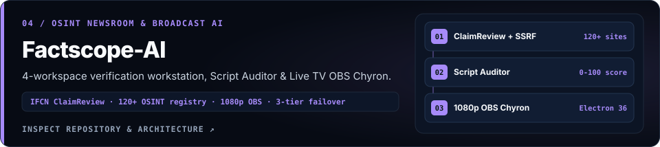
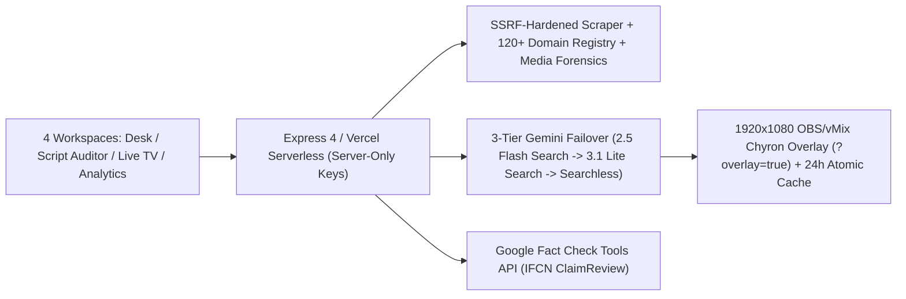

  <a href="https://personalportfolio-theta-gules-56.vercel.app/">
    <picture>
      <source media="(prefers-color-scheme: light)" srcset="assets/hero-light.svg">
      
    </picture>
  </a>

  
  
  
  

  <a href="#choose-your-route">Start here</a> · <a href="#flagship-systems">Flagship systems</a> · <a href="#evidence-matrix">Evidence matrix</a> · <a href="#open-source-and-lab">Open source &amp; lab</a> · <a href="#production-stack">Stack</a> · <a href="#contact">Contact</a>

---

### Full-Stack AI &amp; LLM Systems Engineer — Multi-Agent Workflows, Enterprise RAG &amp; Secure MCP Infrastructure

Most LLM prototypes work in a notebook and fail in production—leaking restricted data across roles, running unsafe SQL or tool calls, hallucinating on edge cases, or burning tokens on checks that should be deterministic. I build the complete vertical slice across **Python (FastAPI)**, **TypeScript (Node.js &amp; React 19)**, **hybrid retrieval**, **MCP tool servers**, and **automated evaluation suites** (`979+` automated tests across flagship repositories).

- **Deterministic before probabilistic:** Run SAST/AST scanners, SQL parsers, and RBAC gates at zero token cost before any LLM call.
- **Security by architecture (not prompts):** Enforce role isolation, PII controls, and worker/SQL sandboxes in code so unauthorized or invalid operations are blocked before reaching data or models.
- **Measured, honest reliability:** Ship regression suites, differential/fuzz tests, RAGAS evals, and CI claims-linters with explicit failure boundaries.

**Lahore, Pakistan (UTC+5 · Remote)** · Open to **Full-Stack AI**, **Forward-Deployed AI**, and **LLM Systems** roles + select **AI architecture & reliability advisory**.

---

## Choose your route

<b>01 · Hiring Engineering Teams &amp; Technical Recruiters — jump straight to verified code proof</b>

Start with **[AI Code Review Agent v3.0](#ai-code-review-agent)** (Python, FastAPI, Tree-sitter AST, CrewAI Flows, 8 MCP tools, `690+` tests) and **[mcp-secure-db](#mcp-secure-db)** (TypeScript/Node 24, 6-layer SQL guardrails, PostgreSQL 17 + SQLite worker, `199` tests), then inspect **[FinSight](#finsight)** (3-layer RBAC Hybrid RAG + DuckDB sandbox, `90` tests).

| Audit artifact | Direct link |
| :--- | :--- |
| Code review architecture &amp; modules | [`docs/ARCHITECTURE_AND_STRUCTURE.md`](https://github.com/hamza1713/AI-Code-Review-Agent/blob/main/docs/ARCHITECTURE_AND_STRUCTURE.md) |
| Deterministic &amp; real-PR benchmarks | [`BENCHMARK_REPORT.md`](https://github.com/hamza1713/AI-Code-Review-Agent/blob/main/BENCHMARK_REPORT.md) |
| CI-enforced MCP security claims register | [`docs/CLAIMS.md`](https://github.com/hamza1713/mcp-secure-db/blob/main/docs/CLAIMS.md) |
| FinSight RBAC security regression tests | [`verification/test_security.py`](https://github.com/hamza1713/Enterprise-RAG-Chatbot-with-Role-Base-Access-Control-/blob/main/verification/test_security.py) |
| FinSight production readiness report | [`PRODUCTION_READINESS_REPORT.md`](https://github.com/hamza1713/Enterprise-RAG-Chatbot-with-Role-Base-Access-Control-/blob/main/PRODUCTION_READINESS_REPORT.md) |
| Factscope security deployment audit | [`SECURITY_CHECKLIST.md`](https://github.com/hamza1713/Factscope-AI/blob/main/SECURITY_CHECKLIST.md) |
| Interactive Systems Lab &amp; Resume PDF | [Interactive Portfolio](https://personalportfolio-theta-gules-56.vercel.app/#lab) · [Resume PDF](https://personalportfolio-theta-gules-56.vercel.app/assets/Hamza_Ali_Resume_GenAI_Engineer.pdf) |

<b>02 · Founders &amp; Engineering Leaders — scoped AI systems &amp; reliability advisory</b>

I partner directly with product and engineering teams to ship production-hardened AI systems:

1. **Enterprise Hybrid RAG &amp; Text-to-SQL with Pre-Retrieval RBAC:** Zero-leak multi-tenant retrieval (`ChromaDB` + `FTS5 BM25` + `RRF` + `Cohere Rerank`), sandboxed analytics, and role-scoped `Redis` streaming caches.
2. **Hardened MCP Tool Servers:** Default-deny RBAC, wire-level tool filtering, local AST validation, worker/DB sandboxing, PII guards, and redacted audit trails for Claude/Cursor/enterprise agents.
3. **Deterministic-First Multi-Agent Workflows:** Static/code-level guardrails ahead of bounded `CrewAI` / `LangGraph` orchestration with durable job queues and fail-closed gateways.
4. **LLM Reliability &amp; Evaluation Audits:** Dual-track `RAGAS` + quota-free evaluation suites, differential/fuzz test harnesses, and explicit degradation paths.

[Email me](mailto:hamza171324@gmail.com?subject=AI%20Systems%20Inquiry) · [Message on LinkedIn](https://www.linkedin.com/in/hamza-ali-ai/) · [Explore Systems Lab](https://personalportfolio-theta-gules-56.vercel.app/#lab)

---

## Flagship systems

Four full-stack AI systems built around deterministic guardrails, explicit access boundaries, and verifiable evaluation suites.

**Prefer deterministic evidence over model opinion.** Runs zero-token SAST, AST constant-folding/taint analysis, Trojan Source (CVE-2021-42574) stripping, slopsquatting checks, and a 6-language Tree-sitter call graph before a bounded 3-agent CrewAI Flows crew and plain-Python reconciler. Ships as a FastAPI/SQLite WAL gateway, React 19 SSE Live Annotated Source Viewer, 8 stdio MCP tools (`code-review-mcp`), 15 PR slash commands, reusable GitHub Action, and OASIS SARIF 2.1.0 exporter.

`Python 3.10–3.13` `FastAPI` `CrewAI Flows` `Tree-sitter` `Semgrep / Bandit / Ruff` `MCP` `SQLite WAL` `React 19` `Docker` `SARIF 2.1.0`

**[Repository](https://github.com/hamza1713/AI-Code-Review-Agent) · [Architecture](https://github.com/hamza1713/AI-Code-Review-Agent/blob/main/docs/ARCHITECTURE_AND_STRUCTURE.md) · [Benchmark Report](https://github.com/hamza1713/AI-Code-Review-Agent/blob/main/BENCHMARK_REPORT.md) · [Tests (`690+`)](https://github.com/hamza1713/AI-Code-Review-Agent/tree/main/tests) · [Case Study](https://personalportfolio-theta-gules-56.vercel.app/projects/ai-code-review-agent)**

<b>Implemented architecture &amp; explicit evaluation scope</b>

- **Verified evidence:** `690+` Pytest tests (Python 3.10–3.13), `14/14` synthetic seeded-defect regression (`18 TP, 0 FP, 0 FN`), and `20/20` Public PR Corpus V2 deterministic capture across frozen real Flask PRs (`24` sourced findings, `3.72s` mean PR latency).
- **Explicit scope:** Synthetic regression fixtures verify known-pattern retention rather than real-world precision/recall; real Flask PR corpus adjudication is explicitly tracked as `UNREVIEWED` in `BENCHMARK_REPORT.md`. Advisory by default (`REVIEW_ENABLE_POSTING` and auto-remediation off by default).

 

**Never trust prompt instructions to protect a database.** A hardened TypeScript/Node 24 MCP reference server (`mcp-use` SDK) enforcing six independent fail-closed layers for read-only agent SQL: default-deny RBAC with wire-level `mcp:tools/list` filtering, zero-LLM local SQL AST validation (`0.334ms` p50), OS `worker_threads` SQLite isolation with compile-time `setAuthorizer` and hard `5s` termination (or pooled PostgreSQL 17 with `BEGIN READ ONLY` + `SET LOCAL ROLE`), 3-point PII guardrails, `untrustedData: true` tagging, rate/row egress budgets, redacted JSONL audit logging, and a CI claims-linter (`[E:CLAIM-NNN]`).

`TypeScript 5.9` `Node.js 24` `MCP (mcp-use)` `node-sql-parser` `node:sqlite (worker_threads)` `PostgreSQL 17` `Vitest` `Docker`

**[Repository](https://github.com/hamza1713/mcp-secure-db) · [Claims Register](https://github.com/hamza1713/mcp-secure-db/blob/main/docs/CLAIMS.md) · [Security Tests (`199`)](https://github.com/hamza1713/mcp-secure-db/tree/main/tests) · [Validator Benchmark](https://github.com/hamza1713/mcp-secure-db/blob/main/bench/validator.bench.ts)**

<b>Implemented 6-layer defense stack &amp; explicit limitations</b>

- **Verified evidence:** `199` automated tests across 16 files (`32` bypass-corpus vectors, `93` differential AST-vs-SQLite tests, `300` grammar-fuzzed queries, `32` self red-team cases, `25` PII bypass tests) + `0.334ms` p50 / `1,668 ops/sec` simple projection AST latency.
- **Explicit scope:** Reference implementation and proof of concept; mitigates tested SQL/PII/DoS classes without claiming formal proof or GDPR/HIPAA/SOC 2 certification, and cannot prevent a prompt-injected agent from reading data its own authenticated role is permitted to access.

 

**Authorization before retrieval—never inside a system prompt.** B.S. CS Final Year Project: a multi-department enterprise AI workspace routing plain-English questions across unstructured documents and CSV spreadsheets with 3-layer RBAC (HS256 JWT + per-request SQLite role revalidation, zero-token pre-LLM department guard, ChromaDB metadata filtering + DuckDB table whitelisting), 4-stage hybrid retrieval (3-way query expansion, ChromaDB dense + SQLite FTS5 BM25, Reciprocal Rank Fusion, Cohere Rerank), an isolated in-memory DuckDB SQL sandbox, and `<20ms` role-scoped Redis NDJSON streaming replay.

`Python` `FastAPI` `React 19` `TypeScript` `LangChain` `ChromaDB` `SQLite FTS5` `DuckDB` `Redis` `Cohere Rerank` `RAGAS` `Docker Compose`

**[Repository](https://github.com/hamza1713/Enterprise-RAG-Chatbot-with-Role-Base-Access-Control-) · [Security Regression Tests](https://github.com/hamza1713/Enterprise-RAG-Chatbot-with-Role-Base-Access-Control-/blob/main/verification/test_security.py) · [Readiness Report](https://github.com/hamza1713/Enterprise-RAG-Chatbot-with-Role-Base-Access-Control-/blob/main/PRODUCTION_READINESS_REPORT.md) · [Case Study](https://personalportfolio-theta-gules-56.vercel.app/projects/finsight)**

<b>Implemented retrieval/SQL pipeline &amp; staging boundaries</b>

- **Verified evidence:** `90` automated tests (`65` backend/RBAC/cache + `20` OWASP security regression + `5` frontend NDJSON stream tests), `0.933` RBAC security score with `0` ChromaDB metadata-filter leaks across 6 roles (`11/12` blocked on a documented general-doc `"revenue"` edge case), and dual-track evals (`0.840` quota-free / `0.894` RAGAS answer relevancy, `0.850` faithfulness).
- **Explicit scope:** Documented honestly as a **staging candidate** with remaining production hardening gates tracked in `PRODUCTION_READINESS_REPORT.md`.

 

**Degrade honestly under quota pressure—and ship to real newsroom workflows.** Four integrated editorial workspaces delivered across Web Serverless, Native Desktop (`Electron 36`), and Live TV Broadcast Graphics (`1920×1080` OBS/vMix/Vizrt lower-third chyron): Intelligence Desk (atomic claim breakdown, parallel IFCN `ClaimReview` API + Gemini Google Search grounding, 120+ domain credibility registry, SSRF-hardened URL scraper, EXIF/generative-AI media forensics), Pre-Publication Broadcast Script Compliance Auditor (`0–100` legal/retraction clearance), Live TV Control Room (`BroadcastChannel` + chroma key), and Analytics Dashboard with a 3-tier graceful Gemini failover engine.

`TypeScript 5.8` `React 19` `Vite 6` `Express 4` `Electron 36` `Tailwind v4` `Gemini 2.5 Flash` `Google Search Grounding` `Vercel Serverless`

**[Repository](https://github.com/hamza1713/Factscope-AI) · [Security Checklist](https://github.com/hamza1713/Factscope-AI/blob/main/SECURITY_CHECKLIST.md) · [3-Tier AI Engine](https://github.com/hamza1713/Factscope-AI/blob/main/server/services/aiEngine.ts) · [Case Study](https://personalportfolio-theta-gules-56.vercel.app/projects/factscope-ai)**

<b>Implemented newsroom &amp; broadcast pipeline + failover tradeoffs</b>

- **Security &amp; resilience:** Zero frontend API key exposure, SSRF protection blocking loopback/RFC1918/cloud metadata (`169.254.169.254`), and explicit UI freshness warnings when Tier 3 runs searchless.
- **Explicit scope:** Model confidence percentages are heuristic indicators rather than calibrated statistical accuracy; cited primary sources always require editorial review before broadcast.

---

## Verified engineering evidence matrix

| System | Primary security / reliability control | Verified quantitative evidence | CI / Audit artifact |
| :--- | :--- | :--- | :--- |
| **[AI Code Review Agent v3.0](https://github.com/hamza1713/AI-Code-Review-Agent)** | Zero-token SAST/AST/Tree-sitter gate + Trojan Source &amp; slopsquatting shields + plain-Python reconciler | `690+` Pytest tests · `14/14` synthetic (`18 TP, 0 FP, 0 FN`) · `20/20` real Flask PRs (`3.72s` mean) |  [`BENCHMARK_REPORT.md`](https://github.com/hamza1713/AI-Code-Review-Agent/blob/main/BENCHMARK_REPORT.md) |
| **[mcp-secure-db](https://github.com/hamza1713/mcp-secure-db)** | 6-layer default-deny RBAC, local AST validator, `worker_threads` 5s kill / PG17 `READ ONLY`, 3-point PII guard | `199` tests (`32` bypass, `93` differential, `300` fuzz, `32` red-team) · `0.334ms` AST p50 |  [`docs/CLAIMS.md`](https://github.com/hamza1713/mcp-secure-db/blob/main/docs/CLAIMS.md) |
| **[FinSight](https://github.com/hamza1713/Enterprise-RAG-Chatbot-with-Role-Base-Access-Control-)** | 3-layer pre-retrieval RBAC + isolated in-memory DuckDB sandbox + role-scoped Redis cache | `90` tests (`20` OWASP) · `0.933` RBAC (`0` filter leaks) · `<20ms` cache · `0.840`/`0.894` relevancy |  [`test_security.py`](https://github.com/hamza1713/Enterprise-RAG-Chatbot-with-Role-Base-Access-Control-/blob/main/verification/test_security.py) |
| **[Factscope-AI](https://github.com/hamza1713/Factscope-AI)** | Server-only credentials, SSRF-hardened scraper, 3-tier failover with explicit searchless banner | 4 workspaces · IFCN `ClaimReview` · `120+` domain registry · `1080p` OBS/vMix chyron · `24h` cache | [`SECURITY_CHECKLIST.md`](https://github.com/hamza1713/Factscope-AI/blob/main/SECURITY_CHECKLIST.md) |

---

## Open source &amp; supporting lab

| Work | Engineering focus | Links |
| :--- | :--- | :--- |
| **Upstream OSS: `mcp-use/mcp-use`** | Contributed role-based SQLite MCP server example demonstrating `mcp-use` RBAC wire middleware (`PR #3055`, open). | [PR #3055](https://github.com/mcp-use/mcp-use/pull/3055) · [Upstream Repo](https://github.com/mcp-use/mcp-use) |
| **Interactive AI Portfolio &amp; Systems Lab** | React/TypeScript showcase featuring interactive Workflow Explorer, Token &amp; Cost Estimator, 8-Tool MCP Protocol Inspector, and Benchmark Matrix (`Verify portfolio` CI passing). | [Live Site](https://personalportfolio-theta-gules-56.vercel.app/) · [Source](https://github.com/hamza1713/Portfolio) · [CI](https://github.com/hamza1713/Portfolio/actions) |
| **Autonomous Social Media Brand Manager** | 5-agent sequential CrewAI orchestration pipeline (Strategy, Copy, Brand Voice, Engagement, Analytics) with brand-guideline tools, mock social adapters, and Streamlit/CLI UI. | [Repository](https://github.com/hamza1713/Autonomous-Social-Media-Brand-Manager) |
| **Deep-Fake Detection** | Experimental multimodal media-analysis interface (React + TypeScript + Vercel Serverless + Gemini); explicitly scopes outputs as heuristic observations rather than calibrated forensics. | [Live Demo](https://deep-fake-detection-pi.vercel.app) · [Repository](https://github.com/hamza1713/Deep-Fake-Detection) |
| **Airline Customer Satisfaction ML** | End-to-end tabular ML workflow: feature engineering, cross-validated XGBoost tuning, held-out evaluation, and feature importance analysis. | [Repository](https://github.com/hamza1713/DS-ML-PROJECTS) |

---

## Production tech stack

| Layer | Core tools &amp; technologies |
| :--- | :--- |
| **AI, Agents &amp; Evals** | Python, TypeScript, CrewAI Flows, LangGraph, LangChain, MCP (Python &amp; TypeScript `mcp-use`), Gemini / Claude APIs, RAGAS, DeepEval, PyTorch, Scikit-learn, XGBoost |
| **Retrieval, SQL &amp; Security** | Hybrid Search (Dense + BM25), Reciprocal Rank Fusion, Cohere Rerank, ChromaDB, DuckDB Sandbox, PostgreSQL 17, SQLite FTS5/WAL, Redis, Tree-sitter, `node-sql-parser`, Semgrep, Bandit, JWT/RBAC |
| **Backend &amp; Testing** | FastAPI, Node.js 24, Express 4, NDJSON / SSE Streaming, Pytest, Vitest, Playwright, Ruff, mypy, Gitleaks, `pip-audit` |
| **Frontend, Desktop &amp; Infra** | React 19, Vite, Tailwind CSS v4, Electron 36, Docker &amp; Docker Compose, Caddy TLS, GitHub Actions, Vercel Serverless, Azure ML |

---

## Let’s build

**Hiring for a Remote Full-Stack / Forward-Deployed AI Engineer role, or scoping a production RAG, MCP, or agent reliability system?**

[hamza171324@gmail.com](mailto:hamza171324@gmail.com) · [LinkedIn (`/in/hamza-ali-ai`)](https://www.linkedin.com/in/hamza-ali-ai/) · [Interactive Portfolio &amp; Systems Lab](https://personalportfolio-theta-gules-56.vercel.app/) · [Resume (PDF)](https://personalportfolio-theta-gules-56.vercel.app/assets/Hamza_Ali_Resume_GenAI_Engineer.pdf)

All metrics, test counts, and architectural diagrams verified directly against public source repositories — November 2026.

[Back to top](#top)
